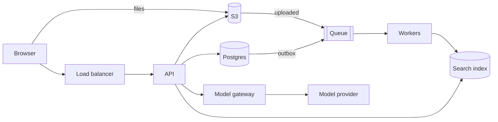

# Taking this to production

The prototype is one process with three stand-ins: documents in memory, a search index cached per version, and a function that calls the model. Production replaces those three and keeps the request path and the change engine. I assume hundreds of tenants, contracts from 20 KB to 10 MB, many more reads than edits, and model calls that dominate cost and latency.

Targets: edit p95 under 300 ms, search p95 under 500 ms, an edit searchable within 10 seconds, 99.9% availability.

| | Decision, what it costs, when I would revisit it |
|---|---|
| Compute | Stateless API and worker containers on ECS Fargate across zones, autoscaled on request rate and queue age. Kubernetes when cost or scheduling justifies a cluster. |
| Storage | Postgres is the record. One transaction holds `UPDATE ... WHERE id = $1 AND version = $2`, the edits and an outbox row. Text is written once to S3, at the cost of a two-step write. No cache tier: the version is the cache key. |
| Documents | Contracts arrive and leave as .docx. Keep the original, map text offsets back to Word runs, and write accepted edits as tracked changes. This is the riskiest part, so I would prototype it first. |
| Ingest | Files go from the browser straight to S3 with presigned URLs, so a bulk upload never passes through the API. Each file is its own queue job: extract the text, index its clauses, mark it ready. A bad file fails alone, progress is a count by status, and a per-tenant cap keeps one import from starving the rest. |
| Search | Workers index clauses in batches, in Postgres full-text so permission filters stay SQL. Hits trail writes by seconds and carry their version. OpenSearch past tens of millions of clauses. |
| Model | A gateway holds the provider keys and enforces timeouts and tenant budgets, under zero-retention terms. Contract text is untrusted input, so the model only proposes. An evaluation set gates prompt and model changes. |
| Security | SSO (SAML or OIDC). Tenant isolation in the data layer, row-level security as a backstop, and the same check in search. TLS, a KMS key per tenant, an append-only audit log. SOC 2 adds access reviews; GDPR adds a DPA and erasure. |
| Delivery | This repo's checks, an image scan and a Terraform plan; staging on merge; a rolling deploy with automatic rollback. Two versions run during a deploy, so migrations expand first and contract later. |
| Resilience | Postgres across zones with point-in-time recovery and a backup in a second region: a zone failure loses nothing, a regional restore loses minutes. Idempotent jobs, a dead-letter queue, a circuit breaker around the provider. |
| Monitoring | Rate, errors and duration per route and tenant, traces through the queue and the model call, no document text in logs. Page when a target is missed for five minutes or the queue is ten seconds behind. |
| Cost | Tokens are the largest cost, so send clauses instead of documents. Right-size from a month of measured utilization. One region: active-active doubles the bill and breaks the single version counter. An EU cell when a customer requires residency. |

First: tenant isolation, SSO, the audit log, tested restores and the .docx round trip. Next: the ingest pipeline, alerts on the targets, model budgets and evaluations in CI.
