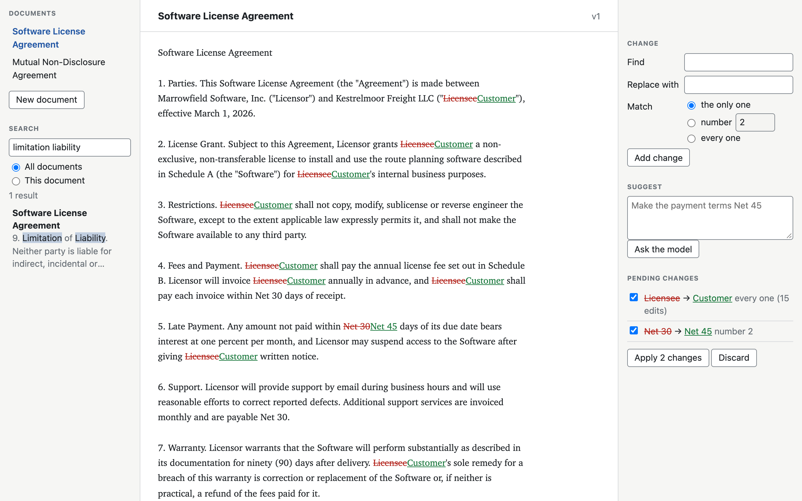

# Redline

A small service for redlining contracts. You send change requests as JSON and get back the updated text and the list of edits. You can search one document or all of them and get the matching clauses, ranked. A model can propose changes, and the service checks each one before a person sees it.

The API is Python and FastAPI, the UI is React and TypeScript, and documents are plain text held in memory. [INFRA.md](INFRA.md) covers what production would need.



## Run it

Needs [uv](https://docs.astral.sh/uv/) and Node 22.12+ or 24+.

```sh
make install
make dev      # API on :8000, UI on http://localhost:5173, two sample contracts loaded
```

`make test`, `make lint` and `make bench` do what they say. Interactive API docs are at http://localhost:8000/docs, and `examples/requests.sh` walks the API with curl (it needs `jq`).

Suggestions need a key: `export ANTHROPIC_API_KEY=...` before `make dev`. Everything else works without one. The model defaults to `claude-opus-5-5` and can be changed with `REDLINE_MODEL`.

## The design in five lines

- There is one way to change a document. A change typed by a person, a bulk replace and a suggestion from the model are the same objects on the same path: matched against one base text, checked the same way, and applied in a single pass or not at all.
- An ambiguous target is an error. Text that appears three times has to say which occurrence it means.
- Every document has a version. A change can say which version it was made against, and a stale one is refused.
- The model can only propose. Its quotes go through the same check as any other change, and nothing is written until a person applies it.
- Documents are plain text in memory. Word files, storage and auth are out of scope and listed at the end.

```
UI --> api.py --> service.py --+--> changes.py   resolve and apply changes   (pure, standard library only)
       HTTP only  use cases    +--> search.py    blocks, index, ranking      (pure, standard library only)
                               +--> store.py     documents in memory
                               +--> suggest.py   the model call
```

## API

| | |
|---|---|
| `POST /documents` | create |
| `GET /documents` | list |
| `GET /documents/{id}` | text and version (`ETag`) |
| `PATCH /documents/{id}` | apply a change set; `?dry_run=true` previews it |
| `GET /documents/search?q=` | search every document |
| `GET /documents/{id}/search?q=` | search one document |
| `POST /documents/{id}/suggestions` | ask the model for changes; never writes |

Why it has this shape:

- Reads are GETs. Once created, a document changes only through `PATCH` with a change set, so the version check, the validation and the list of edits live in one place. An action endpoint per operation (`/replace`, `/replace-all`, `/preview`) would each need its own copy.
- Preview is a flag on the same request, so what you preview is what you commit.
- Search is a read on the collection or on one document. Both routes call the same function.
- Suggestions are the one action-shaped call, a POST because it costs money and is not repeatable. It returns data and leaves the write to `PATCH`.
- Offsets count Unicode code points. A JavaScript client has to convert because its strings are UTF-16, and the UI does that in one module.

### Changes

```sh
ID=$(curl -s localhost:8000/documents | jq -r '.documents[0].id')

curl -X PATCH localhost:8000/documents/$ID \
  -H 'Content-Type: application/json' -H 'If-Match: "1"' \
  -d '{"changes": [
        {"target": {"text": "Net 30", "occurrence": 2}, "replacement": "Net 45"},
        {"target": {"text": "Licensee", "occurrence": "all"}, "replacement": "Customer"}
      ]}'
```

```json
{
  "id": "...", "title": "Software License Agreement", "version": 2, "committed": true,
  "text": "Software License Agreement\n\n1. Parties. This ...",
  "edits": [
    {"change": 1, "start": 176, "removed": "Licensee", "inserted": "Customer"},
    {"change": 1, "start": 275, "removed": "Licensee", "inserted": "Customer"},
    {"change": 0, "start": 924, "removed": "Net 30", "inserted": "Net 45"}
  ]
}
```

(Sixteen edits in all; three are shown.)

A change names its target in one of two ways:

- By quoted text: `{"target": {"text": ..., "occurrence": ...}, "replacement": ...}`. `occurrence` is a number (the nth match), `"all"`, or left out. Left out, the text has to match exactly once, and three matches is a 409 that says so. I would sooner reject an edit to a contract than guess which clause it meant.
- By position: `{"range": {"start": ..., "end": ...}, "text": ...}`, where an empty range inserts. An offset only means something in one version of the document, so this form has to send `If-Match` and is a 428 without it. Search hits carry offsets and a version, so a hit can be edited directly.

For both:

- Every change in a request is matched against the document as it was before the request, so one change can never match text another inserted. Their order only matters for two insertions at the same offset, which keep it.
- If one change fails, none is applied, and the error names it (`changes[1]: ...`). Two changes that touch the same text are rejected.
- Matching is exact: case, spacing and quote characters all count, and matches are counted without overlap, the way `str.replace` counts them. The price is that a straight apostrophe does not match a curly one.
- `edits` is the redline: what was removed, what replaced it and where, in document order. `start` is an offset in the text the changes were applied to.
- Unknown fields are a 422. So are unknown query parameters on `PATCH` and search, and any parameter given twice, so a misspelt `dry_run` cannot turn a preview into a commit. A request carries at most 1,000 changes.

### Versions

Each document has a version number, returned as an `ETag`. Send it back in `If-Match` and the change applies only if nobody else got there first; otherwise it is a 412. Without `If-Match`, a change by quoted text applies to the current version: it lands on text that still exists, though the text around it may have changed. A dry run checks `If-Match` the same way, so a preview against a stale version fails like the commit would.

In this one process, each document has a lock that makes the check and the write atomic. Previews read an immutable snapshot and take no lock. In Postgres the same check is `UPDATE ... WHERE id = $1 AND version = $2`.

### Search

```sh
curl -G localhost:8000/documents/$ID/search --data-urlencode 'q=limitation liability' -d limit=5
```

```json
{
  "query": "limitation liability", "total": 1, "limit": 5, "offset": 0,
  "hits": [
    {
      "document_id": "...", "title": "Software License Agreement", "version": 2, "score": 4.99,
      "start": 1835, "end": 2174,
      "snippet": "9. Limitation of Liability. Neither party is liable for ...",
      "matches": [{"start": 1838, "end": 1848}, {"start": 1852, "end": 1861}, {"start": 2016, "end": 2025}]
    }
  ]
}
```

- A hit is a clause-sized block: a paragraph, cut at a line break, a space or a tab if it runs past 1,000 characters. Paragraphs are separated by blank lines, so hard-wrapped text works. Text with no blank lines at all is cut into blocks of whole lines.
- A block has to contain every query word. Words are runs of letters and digits, matched whole and without regard to case. There is no stopword list, because "shall" and "may" are different obligations. There is no stemming yet, which costs recall: "indemnify" does not find "indemnification".
- Ranking is BM25 over the blocks of the documents being searched. `limit` and `offset` page through the results in a stable order.
- `snippet` is exactly `text[start:end]` and `matches` are document offsets, both at the `version` given. That is what a change by position needs: `{"range": {"start": 1838, "end": 1848}, "text": "Limits"}` with `If-Match: "2"` replaces the first match above.

### Suggestions

`POST /documents/{id}/suggestions` with `{"instruction": "Make the payment terms Net 45"}` asks the model for changes. The model returns quotes and replacements. Each quote then goes through the same resolution and overlap check as any other change: it has to appear exactly once and cannot overlap another suggestion. What passes comes back as changes ready to send, with the version they were checked against. What fails comes back under `rejected` with the reason. Nothing is written. The client previews and applies with `PATCH` and `If-Match` like any other change.

So a quote the model made up cannot become an edit, and text inside a contract that tries to instruct the model can at worst produce a suggestion. It cannot write; a person has to apply it.

Documents over 200,000 characters get a 413, because sending a whole large contract to a model is slow and expensive; retrieving the relevant clauses first is on the list at the end. The model call gets one attempt with a two-minute timeout, and it holds a request thread while it runs. Past a prototype it would be a job with a status URL.

### Errors

Every error is `{ "error": "...", "code": 409 }`. 400, 415 and 422 mean fix the request; 409 and 412 mean look at the document again.

| Code | Meaning |
|---|---|
| 400 | the body is not JSON |
| 404 | no such document |
| 409 | the request is fine but does not fit this document: text not found, ambiguous, no such occurrence, range outside the document, overlapping changes |
| 412 | `If-Match` is not the current version |
| 413 | document too large for suggestions |
| 415 | the body was not sent as JSON |
| 422 | the request is invalid |
| 428 | a change by position was sent without `If-Match` |
| 502, 503 | the model call failed, or no key is configured |

## The UI

One screen. The change form and the model both fill a single pending change set. The preview is a dry run of the checked changes, drawn as a redline, and Apply sends exactly what was previewed, with `If-Match`. Selecting text in the document fills the form with that text and its occurrence number. A search result opens the document at the hit. Only the first 200,000 characters of a document are rendered.

## Performance

`make bench` on an Apple M5 Max with Python 3.12. Best of three runs, engine only (no HTTP), on synthetic contracts:

| operation | 1 MB | 10 MB |
|---|---|---|
| one unique replace | 0.2 ms | 1.3 ms |
| replace every "Agreement" | 2.4 ms (4,526 matches) | 28.6 ms (44,994 matches) |
| change set of 20 distinct terms | 18.0 ms | 196.1 ms |
| build the index | 29.9 ms | 319.0 ms |
| search "agreement shall" | 0.9 ms (1,835 hits) | 8.1 ms (17,953 hits) |
| search "larkspur tamberlane delaware" | 0.1 ms (29 hits) | 0.4 ms (253 hits) |
| scan every block for "agreement shall" (no index) | 17.9 ms (1,835 hits) | 182.5 ms (17,953 hits) |

From 1 MB to 8 MB, replacing every match takes 8.2 times as long and building the index 8.7 times.

- Finding text is `str.find`, which runs in C and has been linear in the worst case since CPython 3.10, when it gained the two-way algorithm. A test times a needle built to defeat naive search.
- Each change is one scan of the text, which is where the 20-term row gets its time. Applying is one pass and one join. So k changes with m edits cost O(k·n) to find and O(n + m log m) to order and apply. Past a few hundred changes in one request I would replace the scans with a single Aho-Corasick pass.
- Search uses an inverted index per document, built in one pass: each word maps to the blocks that contain it. A query intersects the postings of its words starting from the shortest, scores each candidate, and keeps the top page with a heap.
- The index is a pure function of the text, so it is cached by document version and never updated in place. An edit leaves it alone and the next search rebuilds it. That keeps a 10 MB edit at 29 ms where rebuilding on every write would add about 320. A query takes 8 ms through the index against about 180 ms scanning every block, so the index has paid for itself by the third search of a version.
- The index costs memory: about 78 MB of plain dicts for the 10 MB document. Past one machine this is a job for Postgres full-text or OpenSearch.
- The benchmark text comes from seven clause templates, so apart from clause numbers it has about a hundred distinct words. Real contracts have a larger vocabulary.
- `PATCH` returns the whole updated text, which is right at contract size and wasteful at 10 MB. Documents are immutable strings in memory; one too large for that would be spliced as a stream, in the same sorted order of edits.

## Tests

`make test` runs both suites in a few seconds and prints coverage, which has to stay at 100% of lines and branches.

- Unit tests for the change rules and for search, including each rule about overlaps and insertions.
- Property tests (Hypothesis) check the core against simpler versions of itself: a random change set, with both kinds of change, either is rejected or equals a naive regex-and-splice version, and indexed search returns exactly the blocks a brute-force scan finds.
- Concurrency: sixteen threads commit against the same version and exactly one wins. The test shortens the interpreter's thread switch interval, because at the default it also passed with the lock removed.
- Large files: a 10 MB document, plus tests that time 1 MB against 8 MB and fail if the ratio looks quadratic. A ratio holds up on a slow CI machine where a time limit would not.
- The API tests go through HTTP and cover every status code above. The model call is tested against a stub that fails the way the SDK does, including a cut-off answer.
- Mutation testing of the core modules leaves only mutants that cannot change behaviour, such as switching the index cache off. Coverage alone was not enough: at 100%, deleting the ranking sort still passed until a test checked exact scores.

## Left out

- Word files. Real redlines are tracked changes in .docx. This engine works on plain text, and the hard part in production is mapping text offsets back to Word runs without disturbing the formatting.
- History: stored tracked changes that someone else accepts or rejects later, and undo.
- Tolerant matching: curly versus straight quotes and runs of whitespace in changes, stemming in search.
- Phrase, fuzzy and semantic search. Quotes in a query are ignored, and text written without spaces between words needs a different tokenizer.
- Suggestions on large documents, which need the relevant clauses retrieved first.
- Size limits. Nothing caps the size of a request or how far a change set can grow a document.
- Auth, tenancy and persistence, which [INFRA.md](INFRA.md) covers.
